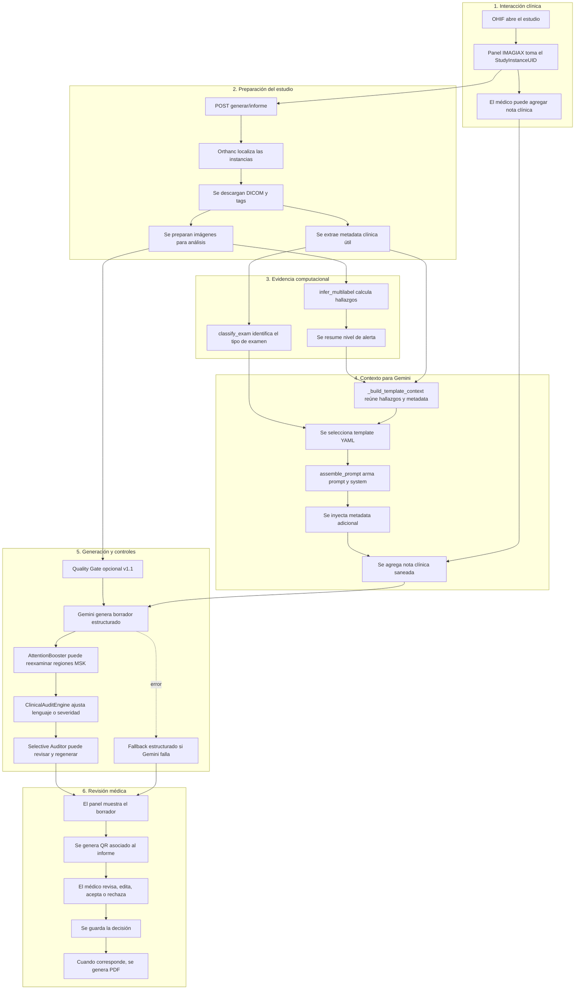
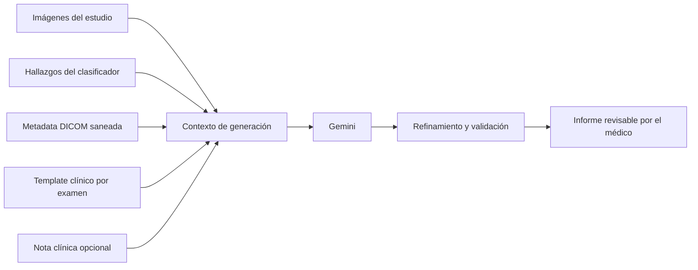

# IMAGIAX — Lectura técnica del sistema

IMAGIAX asiste el análisis radiológico desde OHIF: procesa estudios DICOM, construye contexto clínico y genera un borrador de informe para revisión médica.

- Ruta guiada para el equipo: [`docs/repo-truth/reviewer-map.md`](docs/repo-truth/reviewer-map.md)
- Mapa de componentes: [`docs/repo-truth/authority-matrix.md`](docs/repo-truth/authority-matrix.md)

---

## Flujo general del análisis

Punto clave: Gemini entra en la mitad del recorrido. Antes se preparan imágenes, tags, hallazgos y contexto; después se aplican controles y revisión médica.

---

## Mapa de lectura del código

| Si querés entender... | Empezá por... | Qué mirar |
|---|---|---|
| Inicio desde OHIF | `ohif-extension-imagiax-ai/src/ImagiaxAiPanel.tsx` | disparo del análisis, revisión, edición, PDF |
| Cliente frontend/backend | `ohif-extension-imagiax-ai/src/services/imagiaxApi.ts` | llamadas a `generarInforme`, `guardarDecision`, `getInformesPorEstudio` |
| Orquestación principal | `src/api/ai/router.py` | `generar_informe`, análisis del estudio, auditoría y persistencia |
| DICOM e inferencia visual | `src/infrastructure/dicom_service.py` | tensor, PNG, `infer_multilabel`, nivel de alerta |
| Clasificación y prompts | `app/ai/prompt_orchestrator.py` y `prompts/*.yaml` | template, contexto, nota clínica saneada |
| Integración Gemini | `src/infrastructure/llm_service.py` | generación, fallback, refinamiento y controles posteriores |
| Controles clínicos | `app/ai/quality_gate.py`, `app/ai/auditor.py`, `app/ai/clinical_audit_engine.py`, `app/ai/attention_booster.py` | quality gate, auditoría selectiva y reescrituras |

Si querés una ruta guiada por tiempo o perfil, usá [`docs/repo-truth/reviewer-map.md`](docs/repo-truth/reviewer-map.md).

---

## Por qué el informe se construye por etapas

Porque cada capa cumple una responsabilidad distinta:

- el tipo de examen define qué template y qué reglas clínicas se usan;
- los hallazgos del modelo alimentan el contexto y el nivel de alerta;
- el quality gate puede frenar o marcar estudios subóptimos antes de seguir;
- después de Gemini, el borrador todavía puede ser refinado o auditado;
- la decisión final queda en manos del médico desde el panel.

---

## Qué insumos llegan a Gemini

Conceptualmente, Gemini recibe una combinación de:

1. imágenes derivadas del estudio DICOM;
2. etiquetas o contexto por imagen cuando están disponibles;
3. contexto clínico armado a partir de hallazgos, metadata y tipo de examen;
4. instrucciones especializadas desde templates YAML;
5. nota clínica opcional ya saneada;
6. en algunos templates, parches de alta resolución para zonas específicas.

La generación del informe no depende de una sola entrada: depende de cómo se combinan esas piezas antes y después de la llamada al modelo.

---

## Lectura base recomendada

1. `docs/repo-truth/authority-matrix.md`
2. `ohif-extension-imagiax-ai/src/ImagiaxAiPanel.tsx`
3. `ohif-extension-imagiax-ai/src/services/imagiaxApi.ts`
4. `src/api/ai/router.py`
5. `src/infrastructure/dicom_service.py`
6. `app/ai/prompt_orchestrator.py`
7. `prompts/chest_xray.yaml`
8. `src/infrastructure/llm_service.py`
9. `app/ai/quality_gate.py`
10. `app/ai/auditor.py`

Con ese recorrido se entiende cómo IMAGIAX conecta OHIF, DICOM, inferencia visual, contexto clínico, Gemini y revisión médica.
