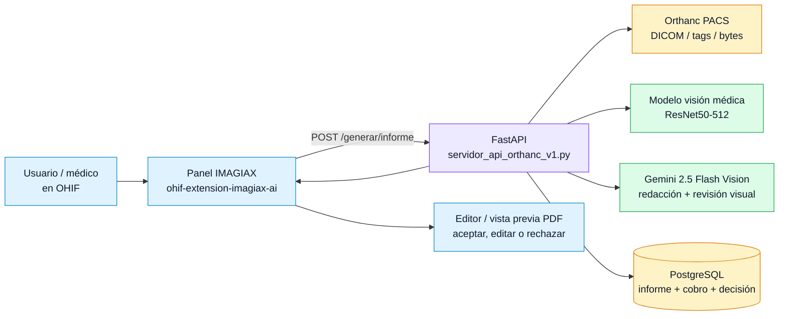
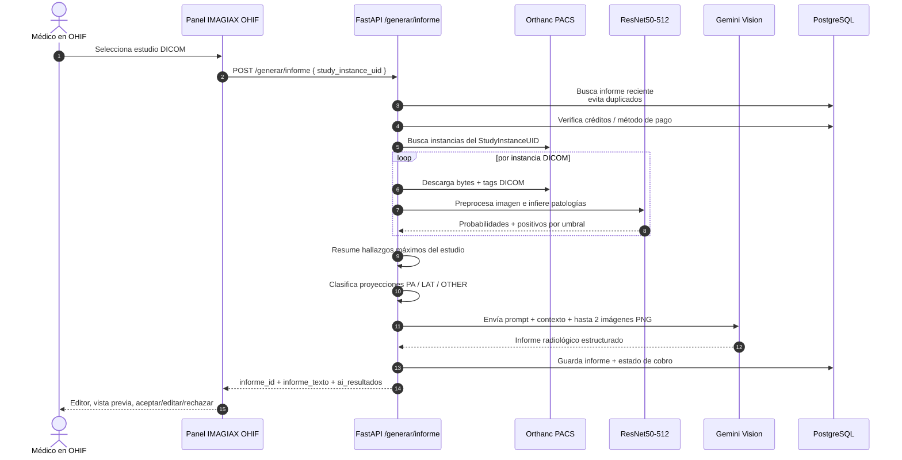
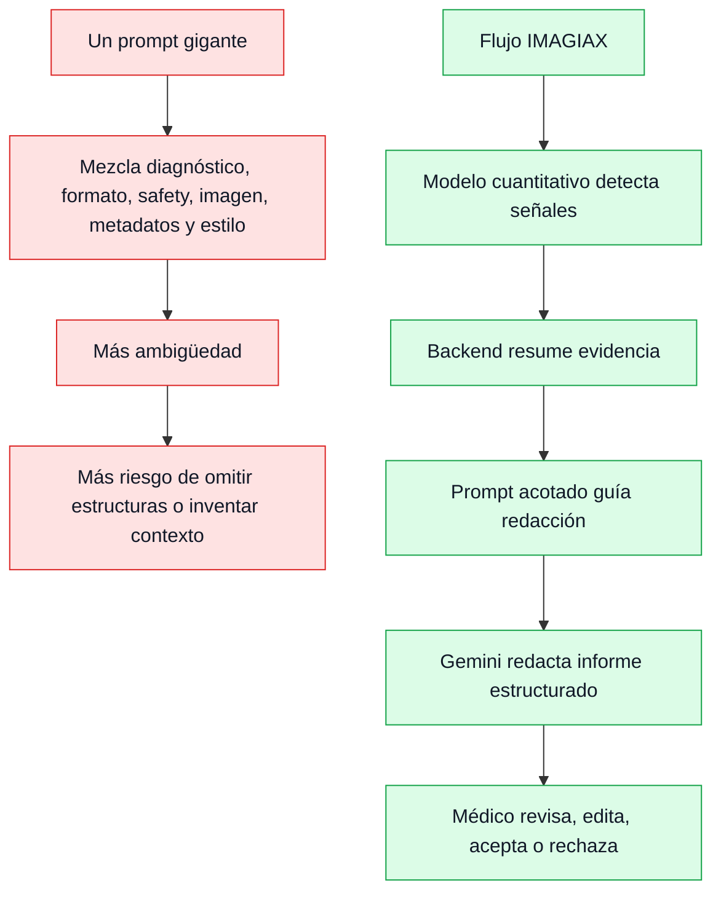
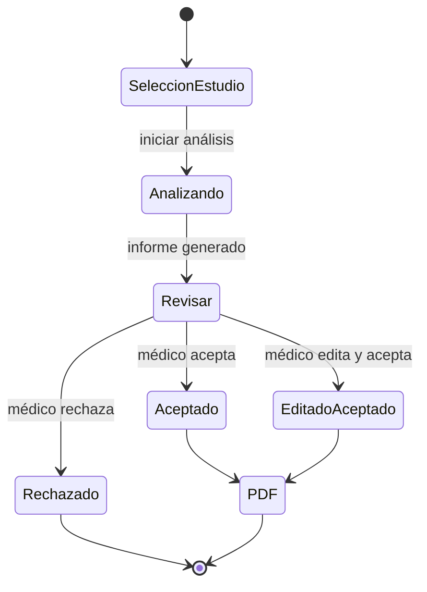

# IMAGIAX — Onboarding técnico local

> **Uso interno / no producción.** Esta rama está pensada para que el equipo pueda clonar el proyecto, entender el flujo real de trabajo y revisar cómo se conecta OHIF + Orthanc + FastAPI + modelo IA + Gemini.

---

## Resumen ejecutivo

**IMAGIAX** es un flujo de apoyo radiológico que toma un estudio DICOM desde OHIF/Orthanc, ejecuta análisis cuantitativo con un modelo de visión médica y usa **Gemini Vision** para redactar un informe clínico estructurado en español.

La idea importante es esta:

> Gemini **no reemplaza** al modelo médico ni al radiólogo. Gemini redacta y razona visualmente con contexto. El backend primero construye evidencia cuantitativa y metadatos; después Gemini recibe una instrucción cuidadosamente acotada para producir un informe profesional.

Estado actual de esta rama:

| Área | Estado |
|---|---|
| Onboarding local | ✅ Documentado y compartible internamente |
| README técnico en español | ✅ Este documento |
| Producción/deploy | ❌ Fuera de alcance |
| Núcleo clínico IA/prompts | ❌ No modificado en esta rama |
| Full-stack local garantizado | ⚠️ No garantizado: Orthanc puede bloquearse en `0.0.0.0:4242` |

Evidencia local: [`docs/onboarding/local-baseline-verification.md`](docs/onboarding/local-baseline-verification.md)

---

## Mapa visual del sistema



---

## Cómo levantarlo localmente

> Este flujo fue verificado en Windows. No promete éxito completo en todas las máquinas porque Orthanc puede fallar al publicar el puerto DICOM `4242`.

### 1. Requisitos verificados

| Herramienta | Estado en baseline |
|---|---|
| Python 3.11 | ✅ Verificado |
| Yarn 1.x | ✅ Verificado |
| Docker CLI/Desktop | ✅ Verificado, pero puede requerir iniciar daemon |

### 2. Ejecutar launcher desde la raíz

```powershell
& ".\INICIAR-IMAGIAX.bat"
```

El launcher delega en:

```text
OHIF Medical Imaging Viewer/orthanc-imagiax/start-imagiax.ps1
```

### 3. Checkpoints reales

| Check | Esperado actualmente |
|---|---|
| `GET /salud` | Endpoint de salud observado en `servidor_api_orthanc_v1.py`; requiere que la API esté levantada |
| PostgreSQL `select 1` | OK en baseline |
| Orthanc `localhost:8042` | Puede fallar si `4242` no bindea |
| OHIF `localhost:3000` | Depende de Orthanc/stack local |

Limitaciones detalladas: [`docs/onboarding/local-current-limitations.md`](docs/onboarding/local-current-limitations.md)

---

## Flujo completo del análisis con IA

El flujo principal está en:

- Frontend OHIF: `ohif-extension-imagiax-ai/src/ImagiaxAiPanel.tsx`
- Cliente API frontend: `ohif-extension-imagiax-ai/src/services/imagiaxApi.ts`
- Backend principal: `servidor_api_orthanc_v1.py`

### Secuencia de alto nivel



### Qué pasa en cada etapa

#### 1. El panel OHIF inicia el análisis

En `ImagiaxAiPanel.tsx`, la función `iniciarAnalisis` valida que haya un estudio activo y llama al cliente API:

```ts
const response = await generarInforme(studyUID);
```

El cliente `imagiaxApi.ts` hace:

```ts
POST /generar/informe
{
  "study_instance_uid": "...",
  "max_instances": 5
}
```

El timeout está separado porque este flujo puede tardar más que un request normal:

```ts
GENERAR_INFORME: 120_000 // 2 minutos
```

#### 2. FastAPI evita duplicados y valida créditos

En `servidor_api_orthanc_v1.py`, el endpoint principal es:

```py
@app.post("/generar/informe")
async def generar_informe(request: GenerarInformeRequest) -> JSONResponse:
```

Antes de gastar cómputo caro, el backend:

1. busca si ya existe un informe reciente para ese estudio;
2. valida créditos o método de pago;
3. recién después descarga y analiza las imágenes.

Esto evita doble-clicks, cobros duplicados y llamadas innecesarias a Gemini.

#### 3. Orthanc entrega las instancias DICOM

El backend busca instancias por `StudyInstanceUID`:

```py
instance_ids = await find_instances_by_query({"StudyInstanceUID": request.study_instance_uid})
```

Luego por cada instancia obtiene:

- bytes DICOM;
- tags relevantes (`PatientID`, `PatientName`, `StudyDate`, `ViewPosition`, etc.);
- metadatos necesarios para el informe.

#### 4. El modelo de visión produce evidencia cuantitativa

El DICOM no se manda “crudo” al modelo. Primero se normaliza:

```py
tensor = dicom_to_tensor(dicom_bytes)
inference = infer_multilabel(tensor)
```

La preparación incluye:

- lectura con `pydicom`;
- aplicación de LUT de modalidad;
- corrección de `MONOCHROME1`;
- escalado robusto por percentiles;
- CLAHE;
- resize a `512x512`;
- normalización esperada por el modelo.

El modelo usado en esta rama se documenta como **ResNet50-512**. Produce probabilidades por patología y se comparan contra umbrales:

```py
positive = probability >= threshold
```

Resultado conceptual:

```json
{
  "nivel_alerta": "MEDIA",
  "hallazgos": [
    { "patologia": "Effusion", "probabilidad_pct": 72.4 }
  ],
  "todas_patologias": {
    "Effusion": { "probabilidad_pct": 72.4, "positivo": true }
  }
}
```

#### 5. El backend resume el estudio, no solo una imagen

Para un estudio con varias instancias, el backend toma el máximo por patología entre imágenes:

```py
max_by_pathology[pat] = max(max_by_pathology[pat], val)
```

Después calcula:

- `hallazgos_estudio`;
- `nivel_alerta` (`NORMAL`, `BAJA`, `MEDIA`, `ALTA`);
- `todas_patologias` para trazabilidad interna;
- proyección probable: PA, LAT u OTHER.

#### 6. Gemini recibe contexto, imagen y reglas de redacción

La generación del informe está en:

```py
async def generar_informe_llm(...):
```

Gemini recibe tres cosas distintas:

1. **Imágenes convertidas a PNG** desde DICOM, máximo 2, priorizando PA y LAT.
2. **Contexto cuantitativo** del modelo: hallazgos confirmados y patologías evaluadas.
3. **Instrucciones clínicas/formato** para producir un informe estructurado en español.

Configuración real observada:

```py
model = "gemini-2.5-flash"
temperature = 0.3
max_output_tokens = 4096
timeout = 90s por intento
reintentos = 4 con backoff
```

También existe fallback estructurado si Gemini falla:

```py
return _generar_informe_fallback(...)
```

---

## ¿Por qué no usar “un solo prompt general” y listo?

Porque ese enfoque mezcla responsabilidades que conviene separar. Acá no se trata de “hacer más prompts porque sí”; se trata de controlar el flujo clínico y reducir ambigüedad.



### Razones técnicas

1. **El modelo de visión y Gemini cumplen roles diferentes**

   El modelo ResNet50-512 entrega señales cuantitativas por patología. Gemini redacta, revisa visualmente y estructura lenguaje clínico. Si le pedís todo a Gemini en un prompt único, perdés una capa determinística de evidencia.

2. **La imagen médica necesita preprocesamiento**

   Antes del análisis hay LUT, inversión MONOCHROME1, percentiles, CLAHE y normalización. Eso no es “prompting”; es ingeniería de imagen médica.

3. **El informe tiene formato obligatorio**

   El backend exige secciones como:

   - `TÉCNICA`
   - `HALLAZGOS`
   - `IMPRESIÓN DIAGNÓSTICA`
   - `OBSERVACIONES VISUALES ADICIONALES`
   - `RECOMENDACIONES`

4. **Hay reglas negativas importantes**

   Gemini recibe instrucciones para no mencionar porcentajes, umbrales, IA, algoritmo ni software en el informe final. Eso protege la salida clínica.

5. **No todo lo detecta el modelo cuantitativo**

   El propio prompt aclara que el análisis cuantitativo cubre un set limitado de patologías. Por eso Gemini debe revisar visualmente estructuras adicionales: aorta, hilios, huesos, dispositivos, cambios degenerativos, etc.

6. **Hay fallback si Gemini falla**

   Si Gemini timeout/falla tras reintentos, el backend genera un informe estructurado básico. Con un prompt único sin arquitectura, ese fallback sería más difícil de controlar.

---

## Anatomía del prompt a Gemini

En esta rama no hay archivos `prompts/*.yaml` incluidos. El prompt principal observado está embebido en `servidor_api_orthanc_v1.py`, dentro de `generar_informe_llm`.

Conceptualmente tiene esta forma:

```text
SYSTEM INSTRUCTION
  Rol: radiólogo experimentado.
  Estilo: informe profesional en español.
  Safety: no mencionar IA, modelos, porcentajes ni software.
  Responsabilidad: revisar todas las estructuras visibles.

USER PROMPT / CONTEXTO
  Edad del paciente, si existe.
  Hallazgos confirmados por análisis cuantitativo.
  Proyecciones disponibles: PA, LAT o estándar.
  Reglas de formato obligatorio.
  Reglas para observaciones visuales adicionales.

CONTENIDO MULTIMODAL
  Imagen PNG derivada del DICOM.
  Si hay 2 imágenes: primera PA, segunda lateral.
```

Ejemplo simplificado:

```py
contents = image_parts + [img_nota + prompt]

response = await client.aio.models.generate_content(
    model="gemini-2.5-flash",
    contents=contents,
    config=genai.types.GenerateContentConfig(
        system_instruction=system_instruction,
        temperature=0.3,
        max_output_tokens=4096,
    ),
)
```

Esto es importante: el prompt no es solo “mirá esta radiografía”. Es una combinación de **imagen + evidencia cuantitativa + metadatos + reglas de formato + restricciones de seguridad**.

---

## Flujo de decisión humana

El informe generado no se entrega como verdad absoluta. El panel OHIF pasa a un estado de revisión:



El médico puede:

- revisar el informe;
- editar secciones;
- aceptar;
- rechazar;
- descargar PDF;
- dejar trazabilidad de decisión.

Esto es CLAVE: la IA asiste, pero el profesional conserva la responsabilidad final.

---

## Archivos clave para estudiar el flujo

| Archivo | Qué mirar |
|---|---|
| `ohif-extension-imagiax-ai/src/ImagiaxAiPanel.tsx` | UI del panel, estados, progreso, revisión del informe |
| `ohif-extension-imagiax-ai/src/services/imagiaxApi.ts` | Cliente HTTP, endpoint `/generar/informe`, timeouts y tipos |
| `servidor_api_orthanc_v1.py` | Pipeline principal: Orthanc, IA, Gemini, DB, cobros |
| `imagiax_db.py` | Persistencia de informes, deduplicación y estado |
| `pagos_mp.py` / `pagos_tbk.py` | Integración de cobro, sin bloquear entrega médica si el informe ya fue generado |
| `docs/onboarding/local-baseline-verification.md` | Evidencia manual de qué funciona y qué está bloqueado localmente |

---

## Rutas HTTP principales

| Endpoint | Rol |
|---|---|
| `GET /salud` | Health del backend observado en esta rama |
| `POST /analizar/instancia` | Analiza una instancia DICOM |
| `POST /analizar/serie` | Analiza instancias de una serie |
| `POST /analizar/estudio` | Analiza un estudio y puede persistir metadata en Orthanc |
| `POST /generar/informe` | Flujo completo: IA + Gemini + persistencia + cobro |
| `POST /informes/guardar` | Guarda decisión final del médico |

---

## Limitaciones honestas de esta rama

1. **No es una rama de producción.**
   Está hecha para onboarding técnico interno.

2. **No garantiza arranque full-stack en cualquier máquina.**
   En baseline, Orthanc puede fallar al bindear `0.0.0.0:4242`.

3. **No modifica el núcleo clínico de IA.**
   Este cambio documenta y mejora onboarding. No cambia modelo, prompts clínicos, inferencia ni comportamiento médico.

4. **Los prompts YAML no están incluidos en esta rama curada.**
   El flujo observable de Gemini en esta rama se explica desde `servidor_api_orthanc_v1.py`.

5. **Hay dependencias clínicas fuera del recorte curado.**
   `servidor_api_orthanc_v1.py` importa `servidor_api_v6`, pero ese archivo no está incluido en esta rama share. Por eso este README explica el flujo observable, no audita todo el detalle interno de `get_model`, `NIH_PATOLOGIAS` o `UMBRALES`.

6. **La salida siempre requiere revisión médica.**
   El sistema es una herramienta de apoyo, no un reemplazo del radiólogo.

---

## Para compañeros que quieran entender el proyecto rápido

Lean en este orden:

1. Este `README.md`.
2. `ohif-extension-imagiax-ai/src/services/imagiaxApi.ts` para ver la llamada al backend.
3. `servidor_api_orthanc_v1.py`, función `generar_informe`.
4. `servidor_api_orthanc_v1.py`, función `generar_informe_llm`.
5. `docs/onboarding/local-runtime-flow.md` para el mapa local.
6. `docs/onboarding/local-current-limitations.md` antes de asumir que el stack falló por error propio.

---

## Guardrails

Este onboarding mantiene límites estrictos:

- no tocar deploy/hosting/prod;
- no tocar prompts clínicos ni motor IA;
- no prometer producción;
- no esconder blockers;
- no presentar resultados de IA como diagnóstico definitivo.

Documento de guardrails: [`docs/onboarding/local-share-guardrails.md`](docs/onboarding/local-share-guardrails.md)

---

## Próximo paso recomendado

Si el objetivo es que todos puedan correr el stack completo sin fricción, el próximo cambio debería ser separado y específico:

> **Investigar y resolver el bloqueo de Orthanc en `0.0.0.0:4242`**, sin tocar producción ni el núcleo clínico.

Hasta entonces, esta rama sirve como package potente de lectura, onboarding y explicación del flujo real.
