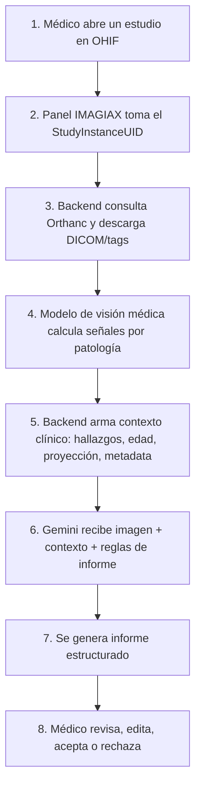
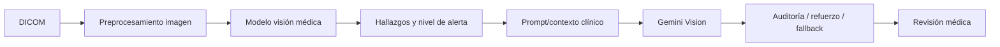

# IMAGIAX — Lectura técnica del sistema

Este branch está preparado para revisar el progreso técnico de IMAGIAX sin mezclar secretos, datos clínicos, archivos de producción o ruido operativo.

El foco es entender el flujo principal: visor OHIF, backend, análisis IA, prompts, Gemini y generación del informe. No está pensado como paquete de despliegue ni como instalación local completa.

Guía de lectura recomendada: [`docs/repo-truth/reviewer-map.md`](docs/repo-truth/reviewer-map.md)

---

## Estado real resumido

Hoy conviven tres capas:

| Capa | Qué significa | Estado honesto |
|---|---|---|
| Runtime productivo documentado | Backend que Docker/deploy siguen usando | `servidor_api_orthanc_v1:app` |
| Modularización previa | Código IA/prompts/tests en `app/ai/**` | Importante para entender evolución, no publicado completo en `origin/main` |
| Modularización más nueva | Código en `src/api/ai/router.py` y `src/infrastructure/llm_service.py` | Flujo más moderno, venía local/untracked antes de este paquete |

La idea es que esta diferencia quede explícita desde el inicio. Así el equipo puede revisar avances reales sin asumir que todo el código incluido corre hoy en producción.

Documento base: [`docs/repo-truth/authority-matrix.md`](docs/repo-truth/authority-matrix.md)

---

## Flujo general del análisis



Punto clave: **Gemini no trabaja aislado**. Antes de llegar a Gemini, el backend ya preparó imagen, tags DICOM, inferencia, filtros, metadatos y contexto clínico.

---

## Qué archivo leer según lo que querés entender

| Si querés entender... | Empezá por... | Nota |
|---|---|---|
| Lo que producción documenta como backend activo | `servidor_api_orthanc_v1.py` | Runtime monolítico |
| El flujo IA más moderno | `src/api/ai/router.py` | Modular target / lectura técnica |
| Cómo se arma el prompt y llamada a Gemini | `src/infrastructure/llm_service.py` | Multi-imagen, capas, auditoría |
| Reglas clínicas por tipo de estudio | `prompts/*.yaml` | Sensible: leer con cuidado, no asumir producción |
| Refuerzos/auditoría clínica | `app/ai/attention_booster.py`, `app/ai/auditor.py`, `app/ai/clinical_audit_engine.py`, `app/ai/quality_gate.py` | Evolución modular |
| Panel OHIF | `ohif-extension-imagiax-ai/src/ImagiaxAiPanel.tsx` | UI, revisión, PDF, login |
| Cliente frontend/backend | `ohif-extension-imagiax-ai/src/services/imagiaxApi.ts` | Endpoints y timeouts |
| Por qué no se hizo cutover | `docs/repo-curation/runtime-cutover-parity-gate.md` | Estado RED/HOLD |

> Nota: este paquete recorta piezas de auth/pagos para mantener el foco en lectura del flujo IA. Esas áreas existen en el sistema, pero no son necesarias para entender cómo se arma el análisis clínico.

Si querés una ruta más guiada por tiempo disponible, usá [`docs/repo-truth/reviewer-map.md`](docs/repo-truth/reviewer-map.md).

---

## Punto importante: 2 imágenes vs 10 imágenes

Esto era una fuente de confusión y hay que decirlo claro.

En el runtime monolítico (`servidor_api_orthanc_v1.py`) aparece una selección acotada:

```py
ordered_for_gemini = (pa_insts + lat_insts + other_insts)[:2]
```

En el flujo modular más nuevo (`src/api/ai/router.py`) aparece:

```py
MAX_GEMINI_IMAGES = 10
ordered_for_gemini = all_ordered[:MAX_GEMINI_IMAGES]
```

Lectura correcta:

- producción documentada sigue apuntando al monolito;
- el flujo modular más nuevo contempla hasta 10 imágenes para Gemini;
- este branch incluye ambos para lectura, pero no debemos presentarlos como si fueran el mismo runtime.

---

## Por qué no basta con “un prompt general”

Porque el problema no es solo escribir texto. El sistema hace varias cosas antes y después de Gemini.



Un prompt único mezclaría demasiadas responsabilidades técnicas y clínicas:

- interpretar imagen;
- decidir qué hallazgos son relevantes;
- respetar formato de informe;
- no mencionar IA/porcentajes cuando no corresponde;
- aplicar reglas por región anatómica;
- considerar edad, proyección, metadata y hallazgos cuantitativos;
- manejar fallos de Gemini;
- permitir revisión médica.

Por eso el enfoque actual se entiende mejor como un **flujo por etapas**: cada etapa reduce ambigüedad y deja más trazabilidad.

---

## Qué recibe Gemini realmente

Depende de la ruta de código, pero conceptualmente recibe:

1. imagen o imágenes derivadas del DICOM;
2. hallazgos cuantitativos del modelo;
3. metadata clínica/DICOM disponible;
4. reglas de formato del informe;
5. instrucciones de estilo y seguridad;
6. en el flujo modular, capas adicionales como templates, quality gate, auditoría o refuerzo.

Ejemplo simplificado:

```py
contents = image_parts + [prompt]

response = await client.aio.models.generate_content(
    model="gemini-2.5-flash",
    contents=contents,
    config=genai.types.GenerateContentConfig(
        system_instruction=system_instruction,
        temperature=0.3,
    ),
)
```

Esto es solo la forma corta. La lógica completa está repartida entre:

- `src/api/ai/router.py`
- `src/infrastructure/llm_service.py`
- `app/ai/**`
- `prompts/*.yaml`

---

## Producción, local y GitHub

Que producción esté estable no significa automáticamente que GitHub estuviera perfectamente actualizado.

La forma honesta de entenderlo:

```text
Producción = contenedor/host corriendo una versión concreta.
GitHub main = foto versionada, pero atrasada.
Repo local = mezcla de código nuevo, cambios pendientes y archivos no trackeados.
Este branch = paquete curado para leer y ordenar la verdad.
```

Por eso no se copia “todo el host” a GitHub. El host puede contener secretos, datos, logs, caches, archivos generados o parches manuales sin trazabilidad. Publicar bien requiere seleccionar, sanear y explicar qué representa cada archivo.

Checklist de publicación: [`docs/repo-truth/publication-safety-checklist.md`](docs/repo-truth/publication-safety-checklist.md)

---

## Limitaciones actuales

- Local puede no levantar end-to-end por Orthanc/puerto `4242`.
- OHIF tiene drift documentado entre canonical y mirror.
- El backend modular está en transición; no hay cutover autorizado.
- Los prompts son parte sensible del núcleo clínico: se incluyen para lectura, no para afirmar validación productiva automática.
- Este branch debe pasar barrido de secretos/PHI antes de publicarse.
- El package de ejecución local vive separado: `share/local-onboarding-package`. Este branch se concentra en lectura técnica.

---

## Lectura base recomendada

1. `docs/repo-truth/authority-matrix.md`
2. `servidor_api_orthanc_v1.py`
3. `src/api/ai/router.py`
4. `src/infrastructure/llm_service.py`
5. `prompts/chest_xray.yaml`
6. `app/ai/quality_gate.py`
7. `app/ai/auditor.py`
8. `ohif-extension-imagiax-ai/src/services/imagiaxApi.ts`
9. `ohif-extension-imagiax-ai/src/ImagiaxAiPanel.tsx`

Con eso se entiende lo esencial: flujo, Gemini, prompts, revisión médica y por qué el sistema no se resuelve con “un prompt gigante y ya”.
